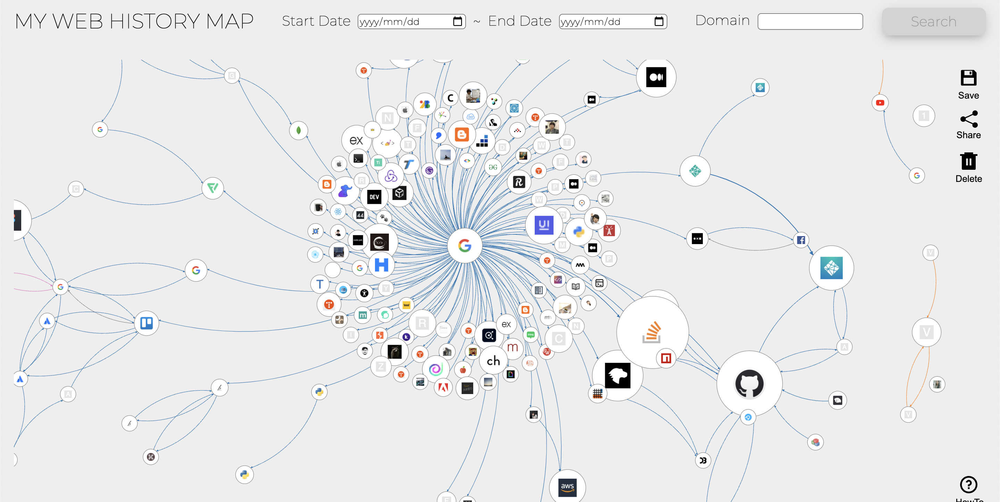
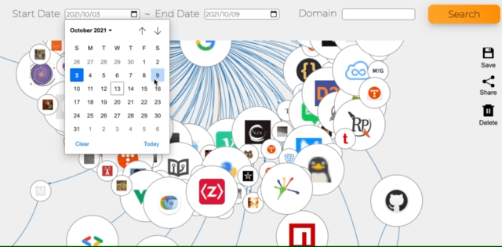
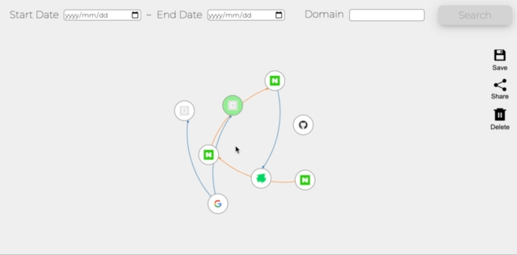
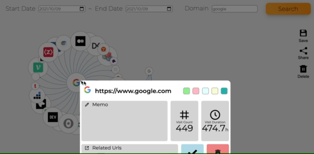
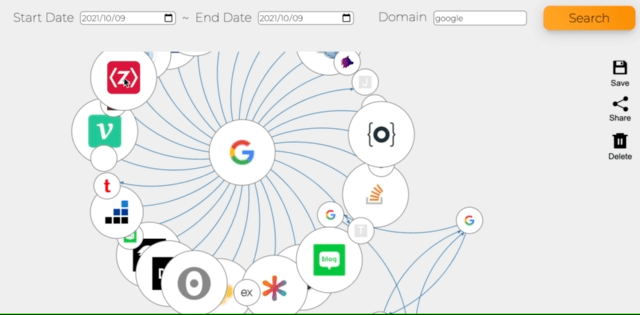
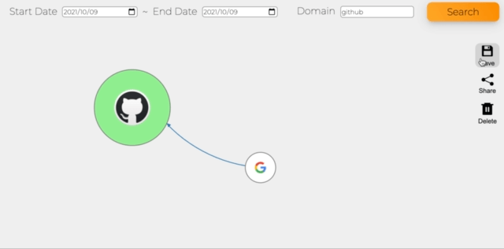

# Visu-visit | Web History Visualization Website

## Contents

- [Visu-visit | Web History Visualization Website](#visu-visit--web-history-visualization-website)
  - [Contents](#contents)
  - [Project Motivation](#project-motivation)
  - [Project Introduction](#project-introduction)
    - [Work Period](#work-period)
    - [Key Features](#key-features)
    - [Deployment Address](#deployment-address)
  - [Project Tech Stack](#project-tech-stack)
  - [Reasons for Stack Selection](#reasons-for-stack-selection)
    - [Typescript](#typescript)
    - [D3](#d3)
    - [Redux](#redux)
    - [Better-sqlite3](#better-sqlite3)
    - [MongoDB](#mongodb)
  - [Issues Encountered During the Project](#issues-encountered-during-the-project)
    - [Accessing User's Web History](#accessing-users-web-history)
    - [Using D3, React, and Typescript Together](#using-d3-react-and-typescript-together)
    - [Privacy and Data Storage Timing](#privacy-and-data-storage-timing)

## Project Motivation

I often found myself opening numerous tabs in my browser for searching and studying, only to delete them all at once later, or occasionally clearing my accumulated browser history. I felt it was a waste to let these accumulated browser history records disappear meaninglessly and thought it would be great to visualize them in a meaningful way, leading to the development of a web history visualization site.

## Project Introduction

### Work Period

- Planning: 2021.09.27 ~ 2021.10.03 (1 week)
- Development: 2021.10.04 ~ 2021.10.15 (2 weeks)

### Key Features

- Uploading a browser's history file displays the web visit history as a directional graph based on the data from that file.
- Uploading the browser history file stored on the user's local computer shows it as a directional graph, which can be moved by dragging the entire graph, zoomed in, and zoomed out.
    
    
    
- You can filter the visit history by a specific period or domains containing a specific name.
    
    
    
- Nodes can be dragged to fix their position, or double-clicked to release their fixation.
    
    
    
- Nodes can be deleted.
    
    
    
- Right-clicking a node displays detailed information about that node (domain). In the detail view, you can change the color of the node or leave notes on it.
    
    
    
- The shape and information of the graph edited so far can be saved on the server and loaded via a URL.
    
    

### Deployment Address

- https://www.visu-visit.com

## Project Tech Stack

- Common(Typescript)
- FrontEnd(React, D3, Redux, Styled-components, Netlify)
- BackEnd(Node, Express, Mongoose, Better-sqlite3, AWS Elastic Beanstalk)

## Reasons for Stack Selection

### Typescript

Choosing Typescript for the first time in this project was anticipated to present an entry barrier. However, it was selected for its static typing with Typescript to reduce runtime errors, ease debugging, and facilitate maintenance in the long run. Although the initial development phase was slow due to unfamiliarity, as usage became more familiar, implementing features became less problematic.

### D3

D3 was chosen for its usefulness in customizing data visualization and its reliability as a well-maintained library over a long period. Initially, I intended to implement the directional graph myself, but considering the needed features, it was determined that implementation within the two-week development period would be impossible. A brief verification of compatibility with React, which I intended to use, and available references for the directional graph encouraged its selection.

### Redux

Anticipating frequent modifications to the web history nodes' positions and multiple components using node data, the choice between Redux and React's context API for global state management had to be made. The decision to use Redux was driven by its defined format, familiarity for quick development, middleware such as logger, and the built-in immer in the toolkit.

### Better-sqlite3

As Chrome's browser history is stored in sqlite3 format, a library handling sqlite was necessary to convert the uploaded history files. Between [sqlite3](https://github.com/mapbox/node-sqlite3) and [better-sqlite3](https

://github.com/JoshuaWise/better-sqlite3), better-sqlite3 was chosen for its clearly superior performance in select query speed, important since conversion of the sqlite3 files was only required at the moment of upload.

### MongoDB

Considering Chrome's browser history is stored in a relational DB (sqlite3), whether to use sqlite3 for the project's DB was deliberated. However, the data needed for the project's planning could be obtained with a single query upon initial file upload. Additionally, as the project's graph data was centered around visit records without requiring relations with other data collections and only quantitative expansion of visit records was considered, managing the DB with sqlite3 was deemed unnecessary, leading to the use of MongoDB.

## Issues Encountered During the Project

### Accessing User's Web History

The initial problem was how to access the user's history file. The recently implemented [File System API](https://developer.mozilla.org/en-US/docs/Web/API/File_System_Access_API) was investigated for the possibility of directly accessing the path where the browser file is stored. However, based on my research, although saving and modifying files in a specified path was possible, reading existing files was not. Therefore, users had to upload files directly, and a screen explaining how to upload files for easy access to the location of the history file was created.

### Using D3, React, and Typescript Together

1. Do React and D3 work well together?
   
   Since both D3 and React deal with the DOM, understanding the operation of both libraries was crucial. To maintain the way React handles the virtual DOM, D3 libraries were passed objects created by React's useRef, allowing D3 to manipulate the DOM not directly but through React.
   
2. D3 and Typescript Generics
   
   Adding zoom in, zoom out, and drag functionalities to the SVG where the directional graph is drawn continuously caused compile errors. It was necessary to define accurate generics, but initially, there was a lack of references using Typescript, and not knowing how D3 operated made it time-consuming to resolve errors. Reading D3's type definition documentation and specifically passing types from the initial DOM selection allowed for the implementation of the intended functionalities. This process not only increased understanding of D3 but also allowed for a deeper appreciation of Typescript's generics in adapting to various types and preventing bugs caused by exceptions.

### Privacy and Data Storage Timing

Web history data could be sensitive information for users, raising concerns about privacy automatically being stored and exposed upon uploading their history file to the website. Some users might only want to view the graph without necessarily storing data on the server. Initially, data was stored in the database immediately upon file upload, but eventually, the server was implemented to merely process the history file into a graph object and transmit it to the client.
